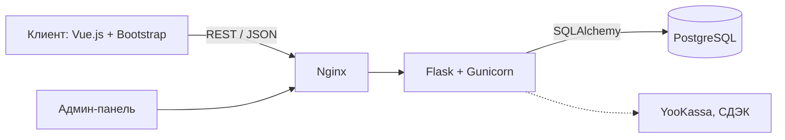

# Чайный магазин — информационная веб-система

Веб-система для чайного магазина: покупатель подбирает чай по типу, региону, обработке и вкусу и оформляет заказ, администратор ведёт ассортимент, остатки и заказы.

> ВКР «Разработка информационной веб-системы для управления продажами и учёта ассортимента в чайном магазине», РАНХиГС, 09.03.03 «Прикладная информатика». Автор — Фирсов В. Д., руководитель — доц. Пономарёва Л. А. Текст работы — в [`docs/`](docs/).

## Назначение и результат

### Проблема

Остатки ведутся вручную, заказы приходят из разных каналов, а универсальные платформы (Shopify, WooCommerce) не позволяют искать чай по сорту, региону, обработке и вкусу.

### Пользователи и основной сценарий

- **Покупатель:** каталог → фильтры → корзина → заказ → статус в личном кабинете.
- **Администратор:** товары и категории, остатки, статусы заказов, отчёты.

### Вклад автора

Требования и модели (IDEF0, Use Case, ER), архитектура, схема PostgreSQL (8 таблиц, 3НФ), прототип на Flask + Vue.js, пользовательское и нагрузочное тестирование.

### Критерий успешного результата

Покупатель без подсказок оформляет заказ, администратор видит его и меняет статус; время ответа ≤ 2 с при 100 RPS (в ВКР — 1,2 с, 99,8 % успешных запросов).

## Демонстрация

// todo: стенда пока нет; нужен скриншот запущенного прототипа

## Архитектура

Пунктир — интеграции, которые в прототипе реализованы не полностью.

## Стек и требования

Python, Flask, SQLAlchemy, PostgreSQL, Vue.js, Bootstrap; сервер — Ubuntu 22.04, Nginx, Gunicorn, Docker.

// todo: версии runtime и СУБД, пакетный менеджер и lock-файлы

## Конфигурация

// todo: переменные из .env.example, где взять значения, что не коммитится

## Quick Start

// todo: clone → .env → зависимости → запуск сервисов → миграции и seed → URL → остановка

## Структура репозитория

- `docs/` — текст ВКР и требования к репозиторию.

// todo: frontend/, backend/, infra/, tests/, compose.yml

## База данных

Таблицы: `clients`, `products`, `categories`, `orders`, `order_items`, `payments`, `deliveries`, `admins`, `history`.

### Миграции

// todo

### Тестовые данные (seed)

// todo: справочники (типы чая, страны, категории, способы доставки) и тестовые товары

### Тестовая учётная запись

// todo

### Сброс состояния

// todo

## API

// todo: ссылка на OpenAPI или документацию контракта

## Тесты и CI

// todo: команда запуска тестов (pytest), что проверяет CI

## Деплой

// todo: разделение локальной и production-конфигурации

## Безопасность

Пароли хранятся как хеш с солью, вход по JWT, обмен только по HTTPS, запросы к БД через ORM.

// todo: работа с секретами, как сообщить об уязвимости

## Известные ограничения

- В репозитории пока нет кода прототипа.
- Оплата и доставка интегрированы не полностью.
- Выше 100 RPS ответ замедляется (200 RPS — 2,8 с): синхронный Flask, нет кеша.

## Обратная связь

Об ошибках — через [Issues](https://github.com/vfirsov/vfirsov-vr22-vkr/issues).

## Лицензия

// todo
