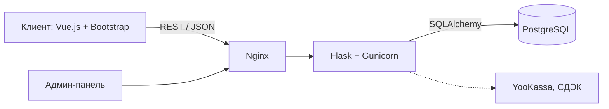

# Чайный магазин — информационная веб-система

Веб-система для чайного магазина: покупатель подбирает чай по типу, региону, обработке и вкусу и оформляет заказ, администратор ведёт ассортимент, остатки и заказы.

Текущее состояние репозитория: материалы ВКР и основа frontend на Vue. Реализованы стартовая страница, пустой каталог и страница для неизвестного маршрута. Backend, база данных и оформление заказов пока не подключены; описание полной системы ниже задаёт целевой результат.

> ВКР «Разработка информационной веб-системы для управления продажами и учёта ассортимента в чайном магазине», РАНХиГС, 09.03.03 «Прикладная информатика». Автор — Фирсов В. Д., руководитель — доц. Пономарёва Л. А. Текст работы — в [`docs/`](docs/).

## Назначение и результат

### Проблема

Работа магазина без единой информационной системы и низкая степень автоматизации деятельности ограничивают эффективность процесса продаж и возможности увеличения их объёма без пропорционального роста нагрузки на сотрудников.

- **Приём и сопровождение заказов.** Заказы и обращения поступают по разным каналам. История общения с покупателем не имеет единого источника правды и хранится в разрозненных каналах коммуникации.
- **Учёт остатков.** Ручное обновление данных приводит к расхождениям между фактическим наличием и доступным для заказа количеством. Возникает риск продажи отсутствующего товара.
- **Возвраты и обращения по качеству и комплектации заказов.** Сведения об обращениях покупателей, заказах и поставках хранятся раздельно. Это затрудняет выяснение обстоятельств инцидента и организацию возврата или замены товара. Если проблема связана с поставкой, сотрудникам также сложно определить партию, поставщика и остатки товаров этой партии.
- **Контроль наличия и планирование закупок.** Без актуальных сведений об остатках и продажах сложно вовремя определить потребность в пополнении ассортимента. Это создаёт риск дефицита востребованных позиций и накопления невостребованного товара.

### Пользователи и основной сценарий

- **Покупатель:** просматривает каталог, применяет фильтры, добавляет товары в корзину, оформляет заказ и отслеживает статус в личном кабинете.
- **Администратор:** товары и категории, остатки, статусы заказов, отчёты.

### Вклад автора

В материалах ВКР описаны требования и модели (IDEF0, Use Case, ER), архитектура, схема PostgreSQL, прототип на Flask + Vue.js, пользовательское и нагрузочное тестирование. Результаты из текста ВКР не являются проверками текущей основы frontend.

### Критерий успешного результата

Покупатель без подсказок оформляет заказ, администратор видит его и меняет статус; время ответа ≤ 2 с при 100 RPS (в ВКР — 1,2 с, 99,8 % успешных запросов).

## Демонстрация

Demo frontend: [tea-shop-frontend-demo-vfirsov.msk1.amvera.tech](https://tea-shop-frontend-demo-vfirsov.msk1.amvera.tech). Развёртывание проверено по HTTPS: главная страница, SPA-маршруты, JS/CSS, `/healthz` и ответ API без backend.

Проект Amvera: `tea-shop-frontend-demo`, регион Москва (`msk1`). Стенд показывает основу интерфейса; каталог пока пуст, покупки и вход недоступны.

## Архитектура

Целевая архитектура полной системы:



Пунктир — внешние интеграции из материалов ВКР. В текущем репозитории они не реализованы.

Развёртываемая сейчас часть: браузер → HTTPS Amvera → Nginx → статическая сборка Vue. После появления backend Nginx сможет передавать запросы `/api/` во Flask.

## Стек и требования

Frontend: Vue 3, TypeScript, Vue Router и Vite; пакетный менеджер npm, зависимости зафиксированы в `frontend/package-lock.json`. Для локальной разработки нужен Node.js 22.12 или новее. Контейнер собирает приложение на Node.js 24 и раздаёт результат через Nginx.

Целевой backend из ВКР: Python, Flask, SQLAlchemy, PostgreSQL и Gunicorn. Его код и конфигурация пока отсутствуют.

## Конфигурация

Для запуска frontend без backend переменные окружения не нужны.

`API_UPSTREAM` — необязательный адрес backend в формате `http://host[:port]` или `https://host[:port]`. Его нужно задавать в окружении контейнера или в переменных проекта Amvera. При запуске контейнера из него формируется конфигурация Nginx; адрес не встраивается в JavaScript при сборке. Префикс `/api/` при проксировании сохраняется. Без `API_UPSTREAM` контейнер отвечает на запросы `/api/` кодом `503` и JSON-сообщением о ненастроенном API.

Frontend обращается к API через относительный путь `/api/`. Данные доступа к БД, ключи платёжных сервисов и другие секреты относятся к backend и не должны попадать в код браузера. Локальные `.env` и `.env.*` исключены из Git; шаблон `.env.example` при необходимости можно хранить в репозитории.

## Quick Start

Команды выполняются из корня репозитория:

```sh
npm ci --prefix frontend
npm run dev --prefix frontend
```

Открыть `http://127.0.0.1:5173`. Остановить сервер — `Ctrl+C`. Это сервер разработки Vite; настройка `/api/`, описанная выше, действует в контейнере Nginx.

Проверка типов и production-сборка:

```sh
npm run typecheck --prefix frontend
npm run build --prefix frontend
```

Результат сборки — `frontend/dist/`. Для проверки контейнера нужен работающий Docker:

```sh
docker build -f frontend/Dockerfile -t tea-shop-frontend .
docker run --rm -p 8080:80 tea-shop-frontend
```

Открыть `http://localhost:8080`; проверка состояния — `http://localhost:8080/healthz`. Остановить контейнер — `Ctrl+C`. Чтобы подключить backend, предварительно задать `API_UPSTREAM` в окружении терминала и передать её без записи значения в команду:

```sh
docker run --rm -p 8080:80 --env API_UPSTREAM tea-shop-frontend
```

## Структура репозитория

- `docs/` — текст ВКР и требования к репозиторию.
- `frontend/` — исходники Vue, настройки Vite и lock-файл npm.
- `frontend/Dockerfile` — сборка frontend и образ Nginx.
- `frontend/nginx/` — конфигурация веб-сервера.
- `amvera.yaml` — параметры сборки и запуска проекта Amvera.
- `.dockerignore` — ограничение контекста Docker-сборки файлами frontend.

Backend, миграции и конфигурация PostgreSQL будут добавлены отдельно.

## База данных

В материалах ВКР описаны таблицы `clients`, `products`, `categories`, `orders`, `order_items`, `payments`, `deliveries`, `admins`, `history`. База данных к текущему frontend не подключена.

### Миграции

// todo

### Тестовые данные (seed)

// todo: справочники (типы чая, страны, категории, способы доставки) и тестовые товары

### Тестовая учётная запись

// todo

### Сброс состояния

// todo

## API

Backend и контракт API пока не реализованы. В контейнере предусмотрен маршрут `/api/` для последующего подключения backend через `API_UPSTREAM`.

## Тесты и CI

`npm run typecheck --prefix frontend` проверяет типы; `npm run build --prefix frontend` повторяет проверку типов и создаёт production-сборку. Автоматические функциональные и нагрузочные тесты пока не настроены.

Workflow [`Frontend CI`](.github/workflows/frontend.yml) использует Node.js 24, устанавливает зависимости по lock-файлу и собирает приложение при push в `main` и pull request в `main`, затрагивающих frontend или конфигурацию сборки. Workflow выполняет только проверки; токены и шаги развёртывания ему не нужны. Результаты запусков доступны в [GitHub Actions](https://github.com/vfirsov/vfirsov-vr22-vkr/actions/workflows/frontend.yml).

Первый [запуск CI 15.11.2026](https://github.com/vfirsov/vfirsov-vr22-vkr/actions/runs/43705958633) не начал выполнение: GitHub сообщил о блокировке аккаунта из-за проблемы с биллингом. Локальная сборка и сборка контейнера в Amvera прошли успешно. Для запуска GitHub Actions требуется устранить ограничение аккаунта.

## Деплой

Demo размещается отдельным проектом `tea-shop-frontend-demo` в Amvera, регион Москва. В корне репозитория находится `amvera.yaml`; Dockerfile расположен в `frontend/Dockerfile`, контекст сборки — корень репозитория. Контейнер слушает порт `80`, внешнее HTTPS-соединение обслуживает Amvera.

Для автоматических обновлений выбрана ветка `main`. Код и workflow CI опубликованы в GitHub, но нативный webhook GitHub → Amvera пока **не настроен**: доступный MCP не содержит метода его настройки, а управление браузером в текущей сессии недоступно. Событие Push позволит обновлять Amvera независимо от доступности GitHub Actions.

Подключение публичного репозитория вручную по [документации Amvera](https://docs.amvera.ru/applications/git/webhooks.html):

1. В Amvera открыть проект → «Репозиторий» → ручную настройку подключения GitHub. Указать публичный репозиторий `https://github.com/vfirsov/vfirsov-vr22-vkr`, целевую ветку `main` и событие **Push**. Создать случайный секрет вебхука, сохранить его вне репозитория, скопировать предложенный Amvera URL и применить настройки.
2. В GitHub открыть репозиторий → **Settings → Webhooks → Add webhook**. В **Payload URL** вставить URL из Amvera, выбрать **Content type: application/json** и указать тот же секрет.
3. Выбрать **Just the push event**. Оставить **SSL verification** включённой и нажать **Add webhook**.
4. После успешной локальной сборки отправить изменение frontend в `main`. Проверить доставку события в **Recent Deliveries**, затем сборку и доступность приложения в Amvera.

После восстановления GitHub Actions можно перейти на событие CI / Workflow runs, изменив его на обеих сторонах и проверив развёртывание после успешного CI.

Порядок обновления:

1. Выполнить локальные проверки и production-сборку frontend.
2. Зафиксировать изменения в Git и доставить их в репозиторий проекта Amvera.
3. При необходимости задать `API_UPSTREAM` в переменных проекта и перезапустить контейнер после изменения переменной.
4. Запустить сборку в Amvera, проверить журналы сборки и запуска.
5. Проверить HTTPS, `/healthz`, открытие и обновление `/catalog`, загрузку JS/CSS и ответ API.

Для отката вернуть в репозиторий проекта содержимое предыдущего рабочего коммита новым коммитом и выполнить пересборку Amvera. Переменные окружения проверяются отдельно: они не входят в Git. Для смены адреса backend достаточно изменить `API_UPSTREAM` и перезапустить контейнер; frontend пересобирать не требуется.

## Безопасность

В целевой системе из ВКР предусмотрены хеширование паролей с солью, вход по JWT, HTTPS и доступ к БД через ORM. В текущем frontend вход и работа с пользовательскими данными не реализованы.

// todo: работа с секретами, как сообщить об уязвимости

## Известные ограничения

- Реализована основа frontend: стартовая страница, пустой каталог и страница для неизвестного маршрута.
- Backend, PostgreSQL, авторизация, корзина, заказы, оплата и доставка пока отсутствуют.
- При работе без backend маршрут `/api/` в контейнере возвращает `503`.
- Нагрузочные показатели из ВКР не подтверждены для текущего кода и Demo-стенда.

## Обратная связь

Об ошибках — через [Issues](https://github.com/vfirsov/vfirsov-vr22-vkr/issues).

## Лицензия

// todo
