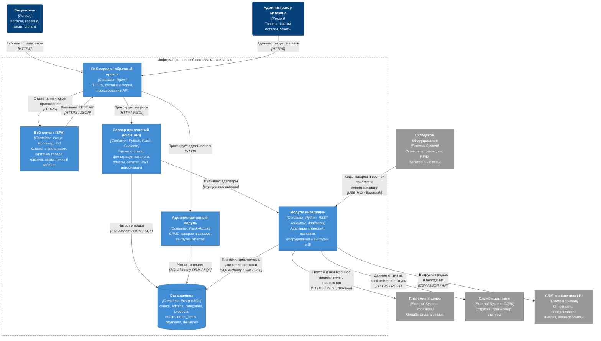

# ADR-0001. Базовая архитектура информационной веб-системы магазина чая (версия 0.0.1)

| | |
|---|---|
| **Номер** | ADR-0001 |
| **Версия архитектуры** | 0.0.1 |
| **Статус** | Принято (Accepted) |
| **Дата** | 2026-09-20 |
| **Автор** | Фирсов В.Д., группа 3Б-ВР-22 |
| **Источник** | `docs/Отчет Фирсов В Д 3Б-ВР-22.docx`, разделы 2.1–2.4, 2.8, 2.9 |

## Контекст

Разрабатывается информационная веб-система для управления продажами и учёта
ассортимента в чайном магазине. Ключевые особенности предметной области,
влияющие на архитектуру:

- **Широкий и многопараметрический ассортимент.** Чай классифицируется по виду
  (чёрный, зелёный, белый, улун, пуэр), региону происхождения, технологии
  обработки, ароматическим добавкам, вкусовому профилю и граммовке упаковки.
  Требуется расширяемая модель каталога и фильтрация по произвольному набору
  атрибутов без переработки серверной логики.
- **Два принципиально разных класса пользователей** — покупатель (каталог,
  корзина, оформление заказа, личный кабинет) и администратор магазина
  (управление товарами, заказами, остатками, отчётность).
- **Обязательные внешние интеграции** — онлайн-оплата, служба доставки,
  складское оборудование, выгрузка данных в CRM/BI.
- **Требование к росту нагрузки** — возможность вынести отдельные модули на
  отдельные серверы или в облако без переписывания системы.

Версия 0.0.1 фиксирует архитектуру уровня прототипа: минимальный набор
развёртываемых компонентов, достаточный для сквозного сценария
«каталог → корзина → заказ → оплата → доставка» и для администрирования.

## Решение

Принята **трёхуровневая клиент-серверная архитектура** с разделением на
клиентскую часть (frontend), серверную часть (backend) и подсистему хранения
данных, где взаимодействие клиента и сервера построено на **REST API поверх
HTTPS с обменом в формате JSON**, а доступ к СУБД — через **ORM SQLAlchemy**.

Все внешние интеграции реализуются как **отдельные модули с чётко
определёнными точками входа** внутри backend-контейнера, а не как прямые
вызовы из бизнес-логики. Это ограничивает область изменений при замене
платёжного шлюза, службы доставки или модели складского оборудования.

Система целиком **контейнеризуется средствами Docker**; фронт принимает
трафик через связку **Nginx + Gunicorn**.

## Модель C4: уровень 2 — Containers

Диаграмма описывает развёртываемые единицы системы (containers в терминологии
C4), их технологии и протоколы взаимодействия между собой и с внешним
окружением.

> **Обозначения:** тёмно-синий — актёры (Person), синий — контейнеры системы (Container), серый — внешние системы (External System). Пунктирная рамка — граница разрабатываемой системы. На каждой связи указаны назначение и протокол/формат обмена.

### Состав контейнеров

| Контейнер | Технологии | Ответственность | Обоснование выбора |
|---|---|---|---|
| Веб-клиент (SPA) | HTML5, CSS3, JavaScript, Vue.js, Bootstrap, fetch API | Каталог, фильтры, карточка товара, корзина, оформление заказа, личный кабинет | Vue.js даёт реактивное обновление списка товаров без перезагрузки страницы, Bootstrap — адаптивность и единообразие карточек товаров |
| Веб-сервер / прокси | Nginx | HTTPS-терминация, статика и изображения товаров, проксирование | Снимает отдачу статики с Python-процессов и даёт единую точку входа |
| Сервер приложений | Python, Flask, Gunicorn | REST API, бизнес-логика, JWT-аутентификация, отчётность | Flask не навязывает жёсткую структуру и позволяет наращивать модули под специфику каталога |
| Административный модуль | Flask-Admin, Bootstrap | CRUD по товарам, категориям, заказам, остаткам; отчёты | Отдельный контур с расширенным API и собственным разграничением прав |
| Модули интеграции | Python, REST-клиенты, драйверы устройств | Адаптеры платежей, доставки, оборудования, выгрузки в CRM/BI | Изоляция внешних протоколов от бизнес-логики |
| База данных | PostgreSQL | Хранение клиентов, каталога, заказов, платежей, доставок | Транзакционность, целостность данных, работа со сложными выборками по множеству атрибутов чая |

### Основные потоки взаимодействия

| Источник | Приёмник | Протокол / формат | Назначение |
|---|---|---|---|
| Веб-клиент | Сервер приложений | HTTPS, REST, JSON | Каталог, заказы, личный кабинет |
| Сервер приложений | PostgreSQL | SQLAlchemy ORM → SQL | Чтение и запись доменных данных |
| Модули интеграции | YooKassa | HTTPS / REST API, токены | Онлайн-оплата и асинхронное подтверждение транзакции |
| Модули интеграции | СДЭК | HTTPS / REST API | Отгрузка, трек-номер, синхронизация статусов |
| Складское оборудование | Модули интеграции | USB-HID / Bluetooth | Приёмка товара, инвентаризация, валидация кодов |
| Модули интеграции | CRM / BI | CSV / JSON / API | Выгрузка данных о продажах и поведении покупателей |

## Рассмотренные альтернативы

| Вариант | Причина отклонения для версии 0.0.1 |
|---|---|
| Монолитное серверное приложение с рендерингом шаблонов на сервере | Не даёт независимости клиента от сервера и закрывает подключение мобильного приложения и внешних систем к тому же API |
| Микросервисная архитектура с самого начала | Избыточна для объёма прототипа: операционная сложность и стоимость сопровождения не окупаются на текущем масштабе |
| Документоориентированная СУБД вместо PostgreSQL | Заказы, платежи и остатки требуют транзакционности и ссылочной целостности; реляционная модель точнее описывает предметную область |
| Прямые вызовы внешних API из бизнес-логики | Привязывает код оформления заказа к конкретному платёжному шлюзу и службе доставки |

## Последствия

**Положительные**

- Компоненты разделены и могут развёртываться и масштабироваться независимо,
  в том числе в облачной инфраструктуре.
- REST API пригоден для повторного использования мобильным приложением и
  внешними CRM-системами, кассовыми терминалами и складским оборудованием.
- Замена платёжного шлюза или службы доставки локализована в модуле интеграции.
- Схема каталога допускает добавление новых атрибутов и фильтров чая без
  изменения логики API.
- Контейнеризация даёт воспроизводимое развёртывание в разных средах.

**Отрицательные и принятые ограничения**

- Клиент и сервер требуют согласованного версионирования контракта REST API.
- Корзина в версии 0.0.1 хранится на стороне клиента (`localStorage`) и не
  синхронизируется между устройствами.
- Все модули интеграции пока разделяют процесс сервера приложений; отказ
  внешней системы может влиять на время отклика API.
- Асинхронная обработка (очереди, фоновые задачи, кэширование) в версию 0.0.1
  не входит — уведомления платёжного шлюза обрабатываются синхронно.
- Единая база данных остаётся общей точкой отказа.

## Дальнейшее развитие

Версия 0.0.1 сознательно не включает следующие элементы, отнесённые к
последующим версиям архитектуры:

- вынесение модулей аналитики и уведомлений в отдельные контейнеры;
- кэширование каталога и фоновая обработка задач;
- оркестрация контейнеров средствами Kubernetes;
- репликация и резервирование базы данных;
- перенос корзины на сервер с привязкой к учётной записи покупателя.
