# System design вариантов реализации

Схемы для восьми вариантов из таблицы «Аналоги и блокеры к их использованию» (слайд 1 презентации к защите, таблица 1.1 ВКР). Каждая схема показывает, как веб-система чайного магазина выглядела бы на этой платформе: где витрина, каталог, остатки и заказы, как подключаются сервисы РФ (платёжный шлюз с картами «Мир» и СБП, служба доставки, онлайн-касса и ОФД по 54-ФЗ, 1С) и в каком месте возникает блокер.

Оценки — из той же таблицы: Л — локализация, У — учёт и атрибуты, И — интеграции РФ, Г — гибкость, А — админ-панель, С — стоимость; итог — среднее.

## Обозначения

- Тёмный блок — ядро, в котором живут каталог, остатки и заказы.
- Сплошная стрелка — синхронный вызов по HTTPS или API.
- Пунктир — обмен по расписанию или через стороннее расширение.
- Пунктирная рамка — то, что магазину пришлось бы писать или поддерживать самому.
- Красное — блокер: связь не работает или нарушает требование.

## Сводка

| № | Вариант | Архитектурный шаблон | Где каталог и остатки | Хостинг | Итог |
|---|---------|----------------------|-----------------------|---------|------|
| 1 | Shopify | SaaS-конструктор | ядро Shopify | ЦОД вне РФ | 3,5 |
| 2 | WooCommerce | CMS + плагины | MySQL WordPress | свой сервер | 3,7 |
| 3 | Adagio Teas | закрытая система одного магазина | недоступно | США | 2,2 |
| 4 | InSales | SaaS-конструктор | ядро InSales | ЦОД в РФ | 4,0 |
| 5 | RetailCRM | CRM + отдельная витрина | CRM и копия в БД сайта | ЦОД в РФ | 4,0 |
| 6 | 1С-Битрикс: Управление сайтом | коробочная CMS | MySQL Битрикса | свой сервер в РФ | 3,7 |
| 7 | 1С:Управление торговлей + витрина | учётная система + витрина | 1С, копия в БД сайта | свой сервер или 1С:Фреш | 4,0 |
| 8 | Собственная разработка | SPA + REST API | PostgreSQL, одна модель данных | сервер в РФ | 4,8 |

Восемь вариантов сводятся к пяти шаблонам. В SaaS (1, 4) своя логика возможна только во внешнем приложении через API. В CMS (2, 6) атрибуты чая ложатся на универсальные «свойства». При раздельных учёте и витрине (5, 7) появляются две копии данных и обмен по расписанию. Закрытую систему (3) подключить нельзя. Собственная разработка (8) держит витрину и учёт в одной модели данных.

## 1. Shopify



Магазин целиком живёт в облаке Shopify; атрибуты чая — метаполя товара. Оплату нельзя провести мимо Shopify Checkout, а российских провайдеров в нём нет, поэтому «Мир», СБП и чеки по 54-ФЗ не подключаются. Доставку и 1С можно подключить только через свой сервис-посредник. Данные покупателей хранятся вне РФ, что противоречит 152-ФЗ.

Исходник: [`src/01-shopify.mmd`](src/01-shopify.mmd)

## 2. WooCommerce



Плагин WordPress на своём сервере, поэтому разместить данные в РФ можно. Атрибуты чая хранятся в `wp_postmeta` и таксономиях, партии не выражаются. ЮKassa, СДЭК и обмен с 1С подключаются только сторонними плагинами, а обновления и безопасность остаются на магазине.

Исходник: [`src/02-woocommerce.mmd`](src/02-woocommerce.mmd)

## 3. Adagio Teas



Это не платформа, а закрытая система одного американского магазина; внутреннее устройство показано обобщённо. Лицензии и API для сторонних магазинов нет, российские сервисы не подключаются. Из варианта взяты только UX-решения (карточка с атрибутами чая, фильтр по вкусу), они вошли в требование F-03.

Исходник: [`src/03-adagio-teas.mmd`](src/03-adagio-teas.mmd)

## 4. InSales



Российский SaaS: платежи, доставка, онлайн-касса и обмен с 1С встроены. Атрибуты чая задаются через механизм «параметров», партионного учёта нет. Свою логику (партии, правила резерва) пришлось бы выносить во внешнее приложение на своём сервере.

Исходник: [`src/04-insales.mmd`](src/04-insales.mmd)

## 5. RetailCRM



RetailCRM закрывает заказы, клиентов и каналы продаж (телефон, мессенджеры), но не витрину. Сайт строится отдельно; каталог передаётся в CRM ICML-фидом, остатки возвращаются на сайт по расписанию. В итоге у товара два источника данных.

Исходник: [`src/05-retailcrm.mmd`](src/05-retailcrm.mmd)

## 6. 1С-Битрикс: Управление сайтом



Коробочная CMS на своём сервере в РФ, все российские интеграции есть. Предметная модель чая ложится на «свойства» инфоблоков, партии не выражаются. Лицензия редакции, ежегодное продление и платные модули Marketplace дают стоимость 2 из 5.

Исходник: [`src/06-1c-bitrix.mmd`](src/06-1c-bitrix.mmd)

## 7. 1С:Управление торговлей + типовая витрина



Учёт в 1С:УТ сильный: партии ведутся как серии номенклатуры, ККТ подключается напрямую. Витрина — отдельный продукт со своей БД, обмен с ней идёт по CommerceML 2 по расписанию. Синхронного резерва в момент оформления нет, и сайт может продать отсутствующую позицию. Лицензии 1С и витрины складываются.

Исходник: [`src/07-1c-ut-storefront.mmd`](src/07-1c-ut-storefront.mmd)

## 8. Собственная разработка (проект ВКР)



Витрина и учётный контур работают в одной модели данных PostgreSQL на сервере в РФ. Резерв остатка выполняется в транзакции при оформлении заказа (F-09). Внешние сервисы подключены через адаптеры и заменяются без правки ядра. Пунктиром показан план на случай роста нагрузки выше 150 RPS.

Исходник: [`src/08-own-development.mmd`](src/08-own-development.mmd)

## Как перерисовать

Схемы описаны на Mermaid в `src/`, оформление (цвета презентации) — в `mermaid.config.json`. После правки исходника:

```sh
./render.sh
```

Скрипт кладёт в `img/` SVG для просмотра и PNG в двойном разрешении для слайдов и Word. Нужен Node.js; mermaid-cli скачивается через `npx`.
